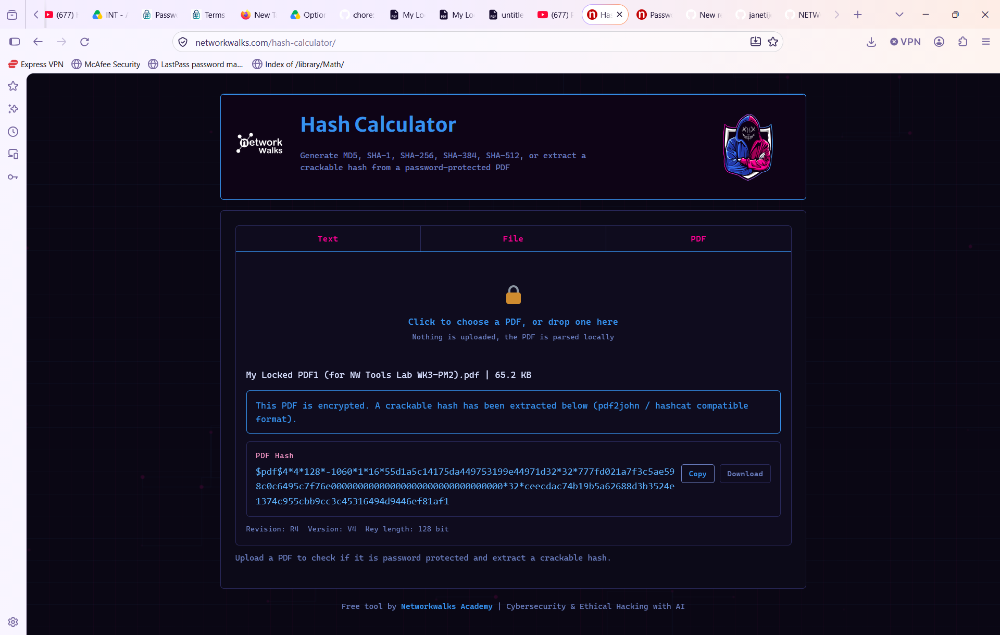
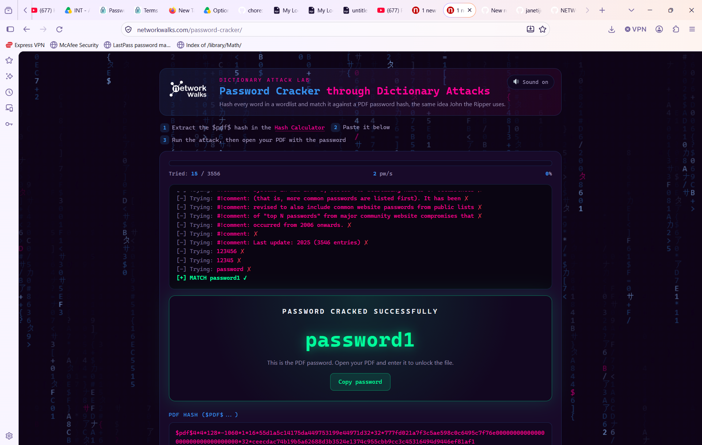
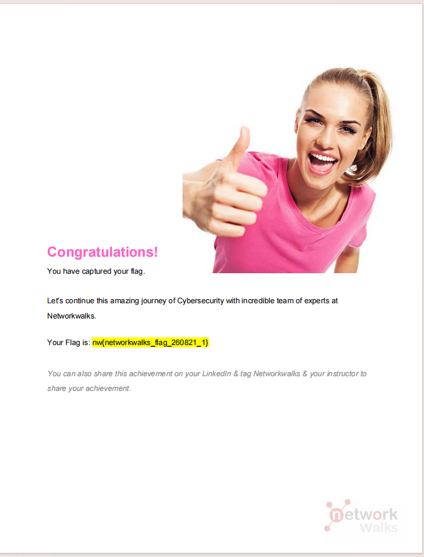

# NETWORKWALKS-B084-WK3-password-hashing
Hands-on exploration of password hashing, hash identification, hash calculation and password security testing using John the Ripper (JTR) and other password auditing tools.
Project Overview

This project documents my Week 3 practical learning activities during my cybersecurity internship at NetworkWalks.

The focus of this week's exercise is understanding password hashing, hash calculation, hash identification and password security testing using cybersecurity tools.

Objectives

Understand the concept of password hashing.

Explore different hashing algorithms.

Generate and analyse password hashes.

Understand how hash calculators work.

Explore password auditing and password-cracking tools.

Gain practical experience using John the Ripper (JTR).

Understand the importance of secure password storage.
Tools Used

Kali Linux – Cybersecurity testing environment.

Hash Calculator – For generating and calculating hashes.

Password Cracker – For authorised password security testing.

John the Ripper (JTR) – Password auditing and hash-testing tool.
Activities Performed

Introduction to password hashing.

Hash generation and identification.

Exploring different hashing algorithms.

Practical exercises with hash calculators.

Introduction to password auditing using JTR.

Observing and documenting password security testing results.

Key Learning Outcomes

Understanding the difference between encryption and hashing.

Learning how hashing algorithms transform input data.

Understanding why password hashing is important.

Exploring password auditing tools.

Understanding the importance of strong passwords and secure authentication.

Screenshots and Evidence

Screenshots of practical exercises and tool outputs will be uploaded here.

Conclusion

Week 3 provided practical exposure to password hashing and password security assessment.

Working with hash calculators and John the Ripper helped strengthen my understanding of how password security can be evaluated and why secure password storage is essential.

 

%20%5BRunning%5D%20-%20Oracle%20VirtualBox%2019_11_2026%2013_15_22.png?raw=true)

%20%5BRunning%5D%20-%20Oracle%20VirtualBox%2019_11_2026%2014_27_37.png?raw=true)

👤 Author
**Nnaemeka Janet**\
Cybersecurity internship B084B
LinkedIn: [https://www.linkedin.com/in/janet-nnaemeka-164a521b3/?lipi=urn%3Ali%3Apage%3Ad_flagship3_feed%3BHgwUBf4MRZOkY9lcbEwcKw%3D%3D

https://www.linkedin.com/in/janet-nnaemeka-164a521b3?utm_source=share_via&utm_content=profile&utm_medium=member_ios

Organisation: NetworkWalks

